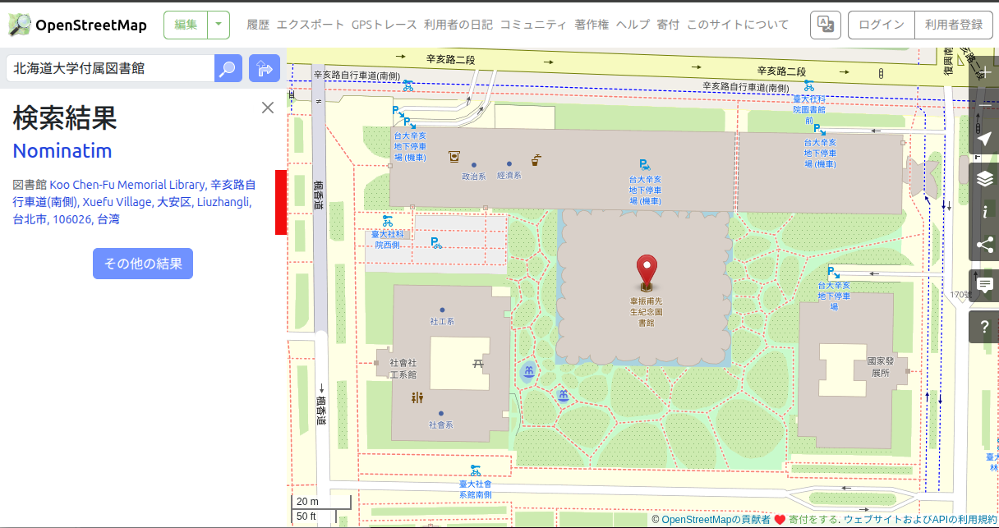
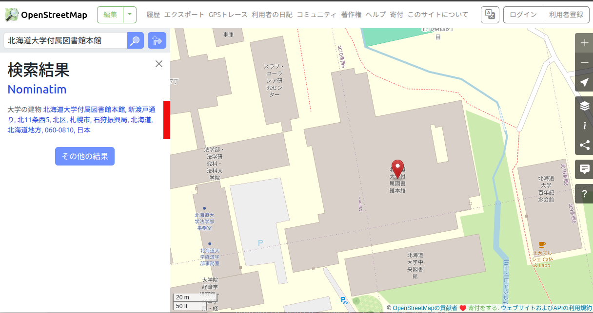

# 続・Nominatimが広島平和記念資料館を見つけられない理由とその解決方法

author
:   阿部 智晃

institution
:   ClearCode Inc.

theme
:   clear-code

# 自己紹介

* 阿部 智晃
  * GitHub: abetomo
* 株式会社クリアコード
  * FOSSの開発・サポートを仕事にしている
  * 全文検索エンジンの開発が主

# FOSS4G 2026 Hiroshima

**「広島平和記念資料館」が見つからない**

* 原因: 検索最適化が裏目に出る
  * 漢字は中国語の読み
* 解決: PGroonga（PostgreSQLの拡張機能）で全文検索！

# 「北海道大学付属図書館」も見つからない！

# 見つからない！を確認

*北海道大学付属図書館* で検索



# 「本館」なら見つかる

*北海道大学付属図書館本館* で検索



# 今回のお話

* PostgreSQLの拡張機能の追加なしでなんとか見つけたい！
* 「検索最適化が裏目に出る」を改善
* Pythonのコードを50行くらいで実現
  * データの再構築なしでOK

# なぜ見つけられないか

「ペナルティ」がいい感じに設定されないから。

# お知らせ

このあと「ペナルティ」についての説明をしていきますが、わかりやすさ優先のため単純化しています。

ご了承ください。

# 前提: 検索クエリーは分割される

クエリーも登録名も単語に分割して照合する

* `Hokkaido University Library`
  * => *`Hokkaido | University | Library`*
* 分割した単語ごとに「ペナルティ」を計算して組み合わせる

# ペナルティ

単語どうしのくっつきやすさ。

* 「北海」と「道」: くっつきやすい => 0
* 「北海」と「阿部」: くっつきにくい => 0.5

{::note}値が小さいほど、より良い組み合わせと見なす{:/note}

# ペナルティがいい感じに設定されない

* 漢字（日本語・中国語）は1文字区切り
  * `北|海|道|大|学|付|属|図|書|館`
  * 形態素解析はしない
  * 意味を無視 => 「くっつきやすさ」が分からない
* クエリーが長いほどペナルティが高くなる

# 検索クエリーが長いとペナルティ高

`|` ごとにペナルティ0.3

* 長: `北|海|道|大|学|付|属|図|書|館`
  * 0.3 * 9 = **2.7**
* 短: `北|海|道`
  * 0.3 * 2 = **0.6**
  * 短いクエリーは影響を受けにくい

# ペナルティ高の補足

単語で分割ならペナルティは低くなるはず

例: `北海道|大学|付属|図書館`

* 「`北海道|大学`」はくっつきやすい => 0
* 全部くっつきやすければ 0 + 0 + 0 = 0

# なぜ高いと見つからないか

1. 名前と住所の分け方の候補をたくさん作る
2. ペナルティの小さい順に試す
3. 最小の候補 + 1.5 を超えたら打ち切り

**正解の候補はあるのに、高すぎて使われない**

{::note}候補の詳細はFOSS4G 2026 Hiroshimaの資料の巻末を参照{:/note}

# 今回のアイディア

ペナルティを適切に設定するために日本語の分割を改善して...は大変。

**日本語（特に漢字）が連続するものはペナルティを低めにすると良いのでは？**

# 今回のアイディア: 具体例

`北|海|道|大|学|付|属|図|書|館`

* Before: `|` ごとに0.3
  * 0.3 * 9 = **2.7**
* After: `|` の前後が日本語なら0.1
  * 0.1 * 9 = **0.9**

# 実装

{::note}追加したコードの一部{:/note}

```python
PENALTY_CJ_CHAR = 0.1
# ...略
def get_cj_partial_penalty(self, trange: TokenRange) -> float:
    penalty = self.nodes[trange.start].partial.penalty
    for pos in range(trange.start + 1, trange.end):
        if self.is_cj_continuation(pos): # 日本語が続いていたら
            penalty += PENALTY_CJ_CHAR # ペナルティは0.1
        else: # そうでなかったら既存のペナルティの追加
            node = self.nodes[pos]
            penalty += node.partial.penalty + node.word_break_penalty
    return penalty
```

# デモ: ペナルティ改善なし

```bash
docker compose exec -e NOMINATIM_CJK_PENALTY=off nominatim \
  nominatim search --query "広島平和記念資料館"

docker compose exec -e NOMINATIM_CJK_PENALTY=off nominatim \
  nominatim search --query "北海道大学付属図書館"
```

# デモ: ペナルティ改善あり

```bash
docker compose exec -e NOMINATIM_CJK_PENALTY=on nominatim \
  nominatim search --query "広島平和記念資料館"

docker compose exec -e NOMINATIM_CJK_PENALTY=on nominatim \
  nominatim search --query "北海道大学付属図書館"
```

# 副作用

見つからなくても良さそうなデータも見つかる…。

{::note}私は真に驚くべき解説をここでしたいが、このスライドはそれを書くには狭すぎるので、ブログ記事で解説します。{:/note}

# 効果がある範囲

* 日本語（J）: 今回発表した通り
* 中国語（C）: 未検証
  * 同様に分割されるので効果はあると思われる
* **韓国語（K）には効果なし**
  * 一文字ずつ分割されないので前提が違う
  * {::note}先ほどの実装例が`cj`だったのはこのため{:/note}

# 他のアプローチ

* ICUのBreakIteratorで分割できそう
  * `広島|平和|記念|資料館`
* ただしインポート全体に影響
  * 全言語・全データで要検証

**もっと良いアイディアがあれば教えてください！**

# まとめ

* ペナルティがいい感じに設定されていなかった
  * **日本語が連続するものはペナルティを低めにして改善**
* そもそも一文字ずつの分割がよくない
  * ここから改善できるとより良い

# 関連リンク

* 本PoC（ペナルティ調整）
  * https://github.com/abetomo/Nominatim
  * `penalty-tuning-for-cjk`ブランチ
* デモ環境
  * https://github.com/abetomo/Nominatim-docker-compose

# ありがとうございました

* Email: abe@clear-code.com
* GitHub: abetomo
* FOSS4G 2026 Hiroshima
  * https://www.clear-code.com/blog/2026/8/19/nominatim-with-pgroonga-ja.html
